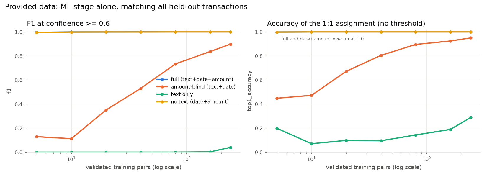
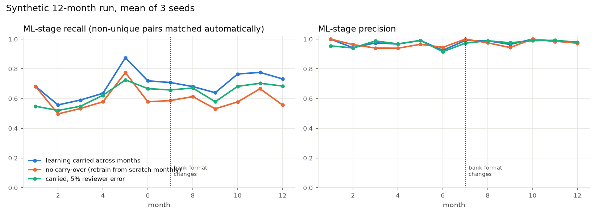

# Analysis

All numbers below are reproduced by `python3 scripts/run_experiments.py` (raw outputs in `results/`). Precision, recall and F1 follow the brief: precision = correct / proposed by the system, recall = correct / pairs that should match, F1 = harmonic mean.

## 1. Performance

### 1.1 Provided data — full pipeline

| Stage | Proposed | Correct | Precision | Recall | F1 |
|---|---|---|---|---|---|
| Unique-amount matching | 286 | 286 | 1.000 | 0.929 (of 308) | 0.963 |
| ML stage (on the 22 pairs left) | 22 | 22 | 1.000 | 1.000 | 1.000 |
| **All automatic matches** | **308** | **308** | **1.000** | **1.000** | **1.000** |

The 22 pairs that reach the ML stage are the 16 with cent-level rounding differences and the 6 that share an amount with another transaction (192.86, 57.56, 105.05 each appear twice). All 22 are matched with confidence ≥ 0.99 and flagged `AMOUNT_DIFFERS` where relevant. The 8 "Unclear transaction" entries are matched and flagged `SOURCE_HAS_ANOMALY_NOTE` for a human to look at.

A perfect score here says more about the dataset than about the model: 93% of pairs are solvable from amount alone, and even with the text model switched off, date + amount reach F1 = 1.0 (E2 below). So I used two harder tests to measure what the ML actually contributes.

### 1.2 Learning from more validated data (E2)

The ML stage alone was trained on *n* randomly chosen validated pairs and then matched **all** remaining transactions (no unique-amount stage), averaged over 5 seeds. To isolate what the "translation" model learns, the key setting is **amount-blind**: amounts are hidden, so the system can only use descriptions, types and dates.

| Training pairs | 5 | 10 | 20 | 40 | 80 | 160 | 240 |
|---|---|---|---|---|---|---|---|
| Amount-blind F1 (conf ≥ 0.6) | 0.13 | 0.10 | 0.34 | 0.54 | 0.75 | 0.83 | **0.91** |
| Amount-blind precision | 0.94 | 0.86 | 0.93 | 0.95 | 0.98 | 0.98 | **0.996** |
| Amount-blind assignment accuracy (no threshold) | 0.45 | 0.45 | 0.68 | 0.80 | 0.91 | 0.93 | **0.95** |

- Performance climbs steadily with validated data, which is the paper's central claim. With few pairs the model is unsure and says so: precision stays above 0.86 while recall is low, because the confidence threshold sends uncertain cases to the human.
- With amounts available, F1 is ≥ 0.997 from just 5 training pairs. Amount is by far the strongest signal in this dataset.
- **Text alone** reaches only 0.31 assignment accuracy at 240 pairs. Descriptions identify the *kind* of transaction ("a grocery purchase") but not *which* one. The value of text is in combination: it breaks ties between same-amount or same-day candidates.

### 1.3 A harder, multi-month benchmark (E5, E6)

The provided file is nearly all unique amounts, so I extended it (`recon/synth.py`, which the brief allows) to 12 months and about 1,300 transactions per seed, using the same vocabulary. The extension adds what makes reconciliation hard in practice:

- **44% non-unique amounts:** round ATM withdrawals, bi-weekly payroll of an identical amount, repeated transfers, coffee at the same price, round fuel top-ups.
- **Noise:** 0–5 day lags with rare outliers up to 11 days, cent rounding differences, typos, mislabelled descriptions, and "Unclear transaction" entries.
- **One-sided entries:** bank-only fees and register-only outstanding cheques.
- **Format drift:** from month 7 the bank changes its descriptor format (`KROGER #1234` → `KROGER STORE 1234 HOUSTON TX`, `AMAZON.COM` → `AMZN MKTP US*…`).

Each month runs the full cycle. A simulated reviewer stands in for QC and for the manual step, and anything still unmatched carries over to the next month.

| 12 months × 3 seeds | ML precision | ML recall | ML F1 | All-auto precision | All-auto recall | All-auto F1 |
|---|---|---|---|---|---|---|
| **Learning carried across months** | 0.974 | **0.698** | **0.813** | 0.992 | **0.887** | **0.936** |
| Retrain from scratch each month | 0.968 | 0.596 | 0.738 | 0.991 | 0.848 | 0.914 |
| Carried, reviewer wrong 5% of the time | 0.975 | 0.627 | 0.764 | 0.992 | 0.883 | 0.935 |

- Unique-amount matching handles 62% of pairs at 99.96% precision. One coincidental match across the 36 months was caught by QC, which shows why the paper keeps a human check even on "certain" matches.
- Carrying validated matches forward raises ML recall by 10 points at the same precision. That is the "improves as more validated matches are added" requirement, measured end to end.
- A 5% reviewer error rate costs about 7 points of recall but no precision. Bad labels make the model less sure rather than confidently wrong. Each error still flows back into training, which is the reinforcement risk the paper warns about.
- **E6, a realistic learning curve.** Testing on the non-unique pairs of the final month, ML F1 rises from 0.66 with 10 training pairs to 0.81 with 200 and 0.83 with all ~1,100.

## 2. Which transactions are hardest

1. **Same amount, same day, same wording.** Coffees at the same price, two ATM withdrawals of 100.00, and the two monthly payroll credits when their lags overlap. When nothing tells two candidates apart, the posterior splits roughly 50/50 and the pair goes to manual review. This is most of the ~30% ML-stage recall gap on synthetic data. It is a choice, not a failure: guessing would be right half the time and would poison the training data the other half.
2. **High-volume, generic categories when amount is unavailable** (amount-blind, 200 training pairs; `results/e3_hardest_categories_provided.csv`): Online Purchase 0.90, Restaurant 0.93, Grocery 0.94 assignment accuracy. Every other category scores 1.00. These categories have many transactions within a few days of each other, and the register uses the same 3–4 phrases for all of them.
3. **Mislabelled descriptions** (`ONLINE PMT WATER` ↔ "Electric bill", `GYM MEMBERSHIP` ↔ "Music subscription"). These are matched correctly on date and amount, but the text cosine is low, so the system raises `DESCRIPTIONS_DISAGREE` once a text model exists.
4. **Cent-level rounding differences.** These are hard for the unique stage, which by design requires exact amounts, and easy for the ML stage. Its learned amount distribution assigns small differences a high likelihood ratio, and that distribution updates as such matches are accepted.
5. **One-sided entries.** Forced 1:1 assignments with negative evidence (log-LR ≤ 0) are dropped, not proposed, so fees missing from the register stay unmatched rather than being paired with something unrelated.

## 3. Design decisions

**Why the paper's SVD approach (Option A) inside a hybrid scorer (Option C).** The core is a faithful implementation of the paper: MI term alignment, a term-by-transaction matrix of concatenated pairs, `X = A·D`, SVD, projection and cosine. It suits this problem. It learns entirely from accepted matches, needs no pretrained model or GPU, handles two vocabularies with no surface overlap (`KROGER` ↔ "Groceries"), and its learned alignments can be inspected (`recon explain`). It learned DEBIT ↔ DR and CREDIT ↔ CR with normalised MI = 1.0 and no rules.

On its own, though, a cosine cannot tell one grocery run from another, so I combined it with the other evidence in a likelihood-ratio model:

- Every component is learned. `P(x | match)` comes from validated pairs, and for the cosine it is cross-fitted so the model is not graded on its own training data. `P(x | non-match)` comes from the unlabelled batch.
- Confidence comes out as a real posterior, which handles duplicates honestly.
- It degrades gracefully. With fewer than 8 training pairs the text component switches off and the system relies on date and amount.

**Why not sentence embeddings (Option B).** A general-purpose model knows that "groceries" and "KROGER" are related, which helps with a cold start. It cannot learn this organisation's conventions, such as that "Paid by check" pairs with `CK #`. It also adds a heavy dependency and is harder to audit, which matters in finance. The architecture leaves room for it: an embedding cosine would be one more learned likelihood-ratio feature.

**Departures from the paper, and why**

| Paper | Here | Reason |
|---|---|---|
| Raw MI as alignment weight | MI ÷ min(H(a), H(b)), positive associations only | puts alignment weights on the same scale as the identity diagonal; MI is sign-blind, so anti-correlated pairs would otherwise be aligned |
| Date lag as descriptor "words" | Learned lag likelihood ratio | a transaction on its own has no lag. Lag only exists for a pair, so it belongs in the pair score |
| Nearest neighbour per query | Global Hungarian 1:1 assignment | greedy nearest-neighbour can give one register entry to two bank entries; reconciliation is a matching, not a retrieval |
| Cosine as the decision | Posterior confidence + threshold | gives an interpretable score and a precision/recall dial (`--threshold`) |
| Words only | + character trigrams, raw type code, amount magnitude, shared-token count | trigrams absorb typos and format drift; the shared-token feature lets identical cheque numbers count (the SVD cannot, because each number appears once) |

**Ablations (amount-blind, mean of 5 seeds; `results/e4_ablation_amount_blind.csv`)**

| Variant | F1 @ 40 pairs | F1 @ 200 pairs |
|---|---|---|
| Default (k = 100, MI top-1, trigrams, overlap) | 0.541 | 0.897 |
| k = 10 / 20 / 40 | 0.511 / 0.535 / 0.541 | 0.827 / 0.902 / 0.887 |
| No MI alignment (plain cross-language LSI) | 0.550 | 0.908 |
| MI alignment, top-3 partners | 0.558 | 0.879 |
| No character trigrams | 0.545 | 0.859 |
| No shared-token feature | 0.471 | 0.896 |

- Fewer than about 20 components hurts. Beyond 20 there is little difference, consistent with the paper's finding that more components did not hurt.
- **The MI alignment step does not measurably help here.** Plain cross-language LSI is equal or slightly better. Because each training document is a concatenated pair, the SVD already sees bank and register terms co-occur, and the alignment matrix mostly re-encodes that. I kept it on by default for fidelity to the paper and because it makes the model explainable, but this is a real finding worth discussing.
- Character trigrams are worth about 4 F1 points at 200 pairs, mostly from typos. The shared-token feature matters most when training data is scarce.

**Other trade-offs**

- **Exact-amount uniqueness, scoped to the batch.** Within the batch is simpler and transparent. The paper tests uniqueness across all history, which is safer, and the 1 coincidental match in E5 is the cost of not doing so.
- **The 0.6 confidence threshold** favours precision. At 0.6, ML precision is about 97–99%. Lowering it raises recall at the cost of more QC rejections.
- **Retraining from scratch each batch.** It takes a few seconds at these sizes (including the 5-fold cross-fitting) and keeps the code simple. Incremental SVD is listed under future work.

## 4. Limitations and future work

**Current weaknesses**

1. **Same-day, same-amount, same-wording duplicates** cannot be resolved from these fields. A real system would add a sequence signal (ordering within the day, running balance on the bank side, which this dataset includes and I do not use) or accept "either assignment is fine" for fungible items.
2. **Cold start.** With no validated pairs, the ML stage has no evidence and falls back to unique amounts plus manual work. An off-the-shelf sentence-embedding prior would help the first month.
3. **Only 1:1 matches.** Split payments, batched deposits and partial refunds (many-to-one) are not handled.
4. **Training-label noise compounds.** Accepted errors reinforce themselves. There is no recency weighting and no mechanism to "unlearn" a pair later found to be wrong, which the paper also flags.
5. **Format drift did not cause a visible dip** in the synthetic run (month 7), because date and amount evidence plus trigrams carry the match while new formats are learned. That is reassuring, but it means the drift scenario as built does not stress the text model hard. A tougher test would combine drift with ambiguous amounts.
6. **Scale.** Scoring is all-pairs, O(N·M), which is fine for thousands of transactions per batch. For millions it would need blocking (amount bands × date windows) or approximate nearest-neighbour search on the SVD vectors.

**With more time**

- Use history-wide uniqueness, as in the paper, and add the bank's running balance as a feature.
- Blocking plus ANN (FAISS) to scale, and incremental SVD updates instead of refits.
- Many-to-one matching (subset sum over candidates within a date window, scored by the same model).
- Active-learning QC: instead of reviewing a random sample, show the reviewer the proposals whose acceptance would teach the model the most (lowest margin), and auto-accept above a confidence level calibrated on past QC outcomes.
- Recency weighting of training pairs, and a "retract" operation that removes a bad pair and retrains.
- A small web UI for QC (the `InteractiveReviewer` interface is already separated from the workflow).

**Edge cases and how they are handled now**

| Case | Behaviour |
|---|---|
| Transaction with no counterpart | Not forced: negative-evidence assignments are dropped; it stays unmatched and is carried over one month |
| Lag outside the learned range, register dated after bank | `DATE_LAG_EXCEEDS_THRESHOLD` / `REGISTER_DATED_AFTER_BANK` flags; confidence reduced |
| Opposite transaction types | `TYPE_MISMATCH` flag (unique stage halves confidence; ML stage learns types as terms) |
| Previously unseen descriptor words | Projected via character trigrams; if nothing is known, the text cosine is 0 and date/amount decide |
| Reviewer rejects a match | Pair is blocked from being re-proposed and never enters training |
| Indistinguishable candidates | Posterior ≈ 0.5 each → manual queue, with the suggestion attached |
